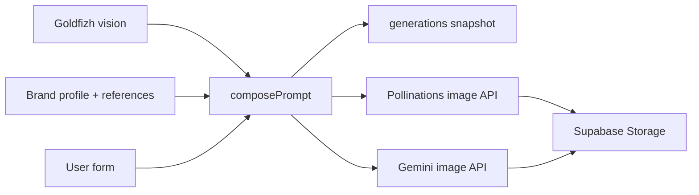

## Stack

- Next.js 16 (App Router), TypeScript, Tailwind CSS 4
- Supabase (PostgreSQL + Storage)
- Image generation: **Pollinations** (default, for demos) or **Google Gemini Nano Banana 2.1** (`gemini-nano-banana-2.1`) via `@google/genai`

## Quick start

```bash
pnpm install
cp .env.example .env
```

Set environment variables (see below), then:

```bash
pnpm exec supabase link --project-ref <your-ref>
pnpm db:push
psql $DATABASE_URL -f supabase/seed.sql
```

On Windows, use your Supabase connection string with `psql`, or run `pnpm db:seed` to reset the linked database and apply migrations plus `supabase/seed.sql` (this wipes existing data in that project).

Upload brand reference images (see below), then:

```bash
pnpm dev
```

Open [http://localhost:3000/studio](http://localhost:3000/studio). The home route redirects to `/studio`.

## Environment variables

| Variable | Required | Description |
|----------|----------|-------------|
| `NEXT_PUBLIC_SUPABASE_URL` | Yes | Supabase project URL |
| `SUPABASE_SECRET_KEY` | Yes | Service role key (server only) |
| `POLLINATIONS_API_KEY` | Recommended | Secret key (`sk_…`) from [enter.pollinations.ai](https://enter.pollinations.ai). Uses `gen.pollinations.ai` and is much more reliable than the anonymous endpoint (especially on Vercel). Free tier Pollen is enough for a few test images. |
| `GEMINI_API_KEY` | For Gemini only | Required when **Image model → Gemini** is selected in the studio |
| `GEMINI_IMAGE_MODEL` | No | Defaults to `gemini-nano-banana-2.1` |
| `SUPABASE_DB_PASSWORD` | For CLI | Database password for `supabase db push` |

Supabase vars are always required. You can run the studio with Pollinations only (no `GEMINI_API_KEY`) as long as **Free (Pollinations)** is selected.

Auth and tenants are **mocked** via a demo session cookie. Swap [`src/lib/session.ts`](src/lib/session.ts) and [`src/lib/demo-sessions.ts`](src/lib/demo-sessions.ts) for real Supabase Auth when integrating into the platform.

## Architecture



- **`src/app/studio/`** — route, Server Actions, request validation (`request-schema.ts`).
- **`src/app/components/studio/`** — studio UI.
- **`src/lib/studio/`** — types, format presets, `composePrompt`, and Supabase access in `data.ts`.
- **`src/lib/pollinations/`** — free-tier image fetch (`gen.pollinations.ai` when a key is set).
- **`src/lib/gemini/`** — Gemini image generation (reference images + 2K output).
- **`src/lib/`** — validated env (`env.ts`), Supabase client, mock session.
- **Precedence:** vision + brand `avoid` lists are merged; user choices only affect allowed fields (page URL, segment, style/colors presets, main swatch, aspect ratio).
- **Repeatability:** each row stores compiled prompt, layer version IDs, model config, and reference asset IDs.

## Image providers

The studio form includes an **Image model** dropdown. Both options use the same compiled prompt from `composePrompt`; only the backend call changes.

**Free (Pollinations)** — default. Good for reviewers to try prompts, styles, and the full flow without a paid Gemini key. Uses a shortened prompt in the URL (full prompt is still stored on the generation row). Output is JPEG at up to 768px; brand reference files are not sent to Pollinations (they remain in the prompt text). Set `POLLINATIONS_API_KEY` for the supported API; without it, the legacy anonymous endpoint may rate-limit or return 503 on shared hosts.

**Gemini** — production-oriented path: multi-image style references from Storage, aspect ratios including **4:5**, and **2K** output. Requires `GEMINI_API_KEY` and billing on the Google AI project.

Prompt compilation is **not** delegated to an LLM so results stay auditable and testable (`compose-prompt.test.ts`).

## Demo data

Two tenants in `supabase/seed.sql`:

- **Nordwind Bank** — cool minimal fintech
- **Roastworks Coffee** — warm artisan coffee

Use the header dropdown to switch clients (tenants) and compare the same form choices across brands.

## Brand reference images (manual)

After running `supabase/seed.sql`, two `brand_assets` rows exist but the files are not in Storage yet. Pollinations generation still works without them; with them, **Gemini** gets style references as image inputs.

1. Open **Supabase Dashboard → Storage → `brand-assets`** (private bucket).
2. Upload your images with these **exact object paths** (create folders as needed):

   | Path | Tenant |
   |------|--------|
   | `11111111-1111-4111-8111-111111111111/nordwind-ref.png` | Nordwind Bank |
   | `22222222-2222-4222-8222-222222222222/roastworks-ref.png` | Roastworks Coffee |

3. Use any PNG/JPEG you like (brand mood boards, photo samples, etc.). Paths must match `storage_path` in `supabase/seed.sql`.

**CLI alternative** (service role key in env):

```bash
curl -X POST "%NEXT_PUBLIC_SUPABASE_URL%/storage/v1/object/brand-assets/11111111-1111-4111-8111-111111111111/nordwind-ref.png" \
  -H "Authorization: Bearer %SUPABASE_SECRET_KEY%" \
  -H "Content-Type: image/png" \
  --data-binary "@path/to/your-image.png"
```

Repeat for the Roastworks path with your second file.

## Scripts

| Command | Purpose |
|---------|---------|
| `pnpm dev` | Local development |
| `pnpm build` | Production build |
| `pnpm start` | Run production build locally |
| `pnpm lint` | ESLint |
| `pnpm typecheck` | TypeScript |
| `pnpm test` | Vitest (prompt compiler) |
| `pnpm db:push` | Apply migrations to linked Supabase project |
| `pnpm db:seed` | Reset linked DB, migrations + seed (destructive) |

For a production-style run locally: set env vars, `pnpm build`, then `pnpm start`.

## Reflection

See [REFLECTION.md](./REFLECTION.md).
